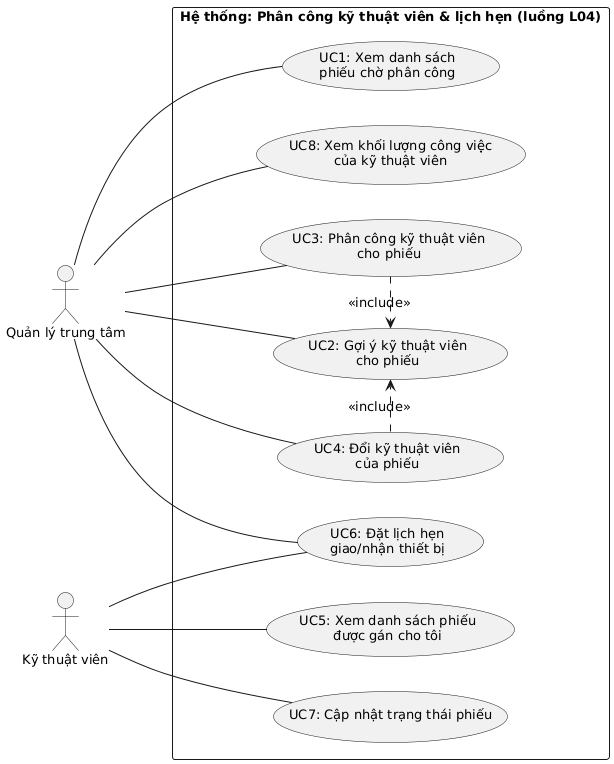
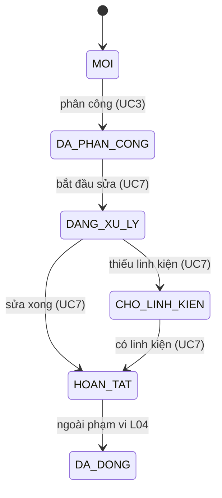

# SRS RÚT GỌN – SMART CRM MEKONG MOBILE
## Luồng L04: Phân công kỹ thuật viên và lịch hẹn

| | |
|---|---|
| **Sinh viên** | Nguyễn Quốc Việt – MSSV 2374802010556 |
| **Track** | SE |
| **Học phần** | Chuyên đề Tốt nghiệp 1 – Trường ĐH Văn Lang |
| **Phiên bản / ngày** | v0.1 – 03/10/2026 |
| **Repo** | https://github.com/NguyenQuocViet23/smartcrm-2374802010556-phan-cong-ky--thuat-vien-va-lich-hen |

> **Chuẩn tham chiếu:** tài liệu được soạn theo cấu trúc SRS rút gọn 6 mục của học phần, *lấy tinh thần* của ISO/IEC/IEEE 29148 (chuẩn thay thế IEEE 830-1998), không tuân thủ đầy đủ chuẩn nào.

---

## 1. Giới thiệu và phạm vi

### 1.1. Bối cảnh doanh nghiệp
Mekong Mobile là chuỗi bán lẻ điện thoại, máy tính bảng, phụ kiện kèm dịch vụ bảo hành – sửa chữa (24 cửa hàng, 6 trung tâm bảo hành, 38 kỹ thuật viên, trung bình khoảng 260 yêu cầu bảo hành mỗi tháng). Hiện việc phân công kỹ thuật viên do quản lý làm thủ công theo trí nhớ, khối lượng công việc lệch nhau (có người 40 phiếu/tháng, người khác 12 phiếu – vấn đề **V3**) và khoảng 15% phiếu quá hạn cam kết mà không được cảnh báo (vấn đề **V2**).

### 1.2. Phạm vi (một câu)
Quản lý trung tâm xem danh sách phiếu bảo hành chờ phân công, hệ thống đề xuất kỹ thuật viên phù hợp theo trung tâm, tay nghề và khối lượng công việc hiện tại, quản lý xác nhận phân công; sau đó đặt lịch hẹn giao/nhận thiết bị có kiểm tra trùng lịch và cập nhật trạng thái phiếu đến khi **HOÀN TẤT**.

- **Điểm bắt đầu:** phiếu bảo hành ở trạng thái MỚI (đã được tạo từ luồng L2).
- **Điểm kết thúc:** phiếu đã gán đúng một kỹ thuật viên, lịch hẹn được lưu, trạng thái phiếu và lịch sử chuyển trạng thái được lưu thành công.

### 1.3. Điều chủ ý KHÔNG làm (mức WON'T)
| # | Hạng mục không làm ở phiên bản này | Lý do |
|---|---|---|
| W1 | Tiếp nhận, tạo phiếu, phân loại nhóm sự cố và mức ưu tiên | Thuộc luồng L2; phiếu mẫu lấy từ dữ liệu có sẵn |
| W2 | Quản lý tồn kho, xuất linh kiện (lý do "chờ linh kiện" chỉ là một trạng thái) | Thuộc luồng L5 |
| W3 | Chuyển phiếu sang **ĐÃ ĐÓNG** / **ĐÃ HỦY** và gửi khảo sát hài lòng | Thuộc L2/L8; phạm vi L04 dừng ở HOÀN TẤT |
| W4 | Gửi tin nhắn/SMS/Zalo nhắc lịch hẹn cho khách hàng | Cần tích hợp dịch vụ ngoài; ghi vào hướng mở rộng |
| W5 | Tự động chuyển phiếu sang trung tâm khác khi không có kỹ thuật viên phù hợp | QT-08 giới hạn cùng trung tâm; xử lý thủ công ngoài hệ thống |
| W6 | Báo cáo tổng hợp quá hạn toàn công ty, dashboard cho Ban giám đốc | Thuộc luồng L6 |
| W7 | Tối ưu lộ trình, tính toán thời gian di chuyển của kỹ thuật viên | Ngoài nhu cầu nêu trong case study |

### 1.4. Bảng thuật ngữ (dùng đúng MỘT tên trong toàn bộ tài liệu và sơ đồ)
| Thuật ngữ | Định nghĩa | Tên kỹ thuật |
|---|---|---|
| Phiếu bảo hành | Một yêu cầu bảo hành/sửa chữa, có mã duy nhất và vòng đời trạng thái | `ticket` |
| Trạng thái phiếu | MỚI → ĐÃ PHÂN CÔNG → ĐANG XỬ LÝ → (CHỜ LINH KIỆN) → HOÀN TẤT | `ticket_status` |
| Hạn cam kết (SLA) | Thời điểm chậm nhất phải hoàn tất phiếu, sinh theo mức ưu tiên | `due_date` |
| Mức ưu tiên | CAO / TRUNG BÌNH / THẤP | `priority` |
| Nhóm sự cố | MÀN HÌNH, PIN, SẠC, PHẦN MỀM, NƯỚC VÀO, KHÁC | `issue_category` |
| Kỹ thuật viên | Nhân viên sửa chữa, thuộc một trung tâm, có tay nghề theo nhóm sự cố | `technician` |
| Tay nghề | Mức thành thạo 1–5 của kỹ thuật viên theo từng nhóm sự cố | `technician_skill.proficiency` |
| Trung tâm | Trung tâm bảo hành (6 trung tâm) | `service_center` |
| Lịch hẹn | Khung thời gian hẹn giữa khách và kỹ thuật viên để giao hoặc nhận thiết bị | `appointment` |
| Khối lượng công việc | Số phiếu kỹ thuật viên đang giữ (xem giả định A1) | `workload` |
| Lịch sử trạng thái | Bản ghi mỗi lần phiếu đổi trạng thái | `ticket_status_log` |

---

## 2. Các bên liên quan và vai trò người dùng

| Actor | Loại | Được làm | Không được làm |
|---|---|---|---|
| **Quản lý trung tâm** | Chính | Xem phiếu chờ phân công; xem gợi ý; phân công và đổi kỹ thuật viên cho phiếu **của trung tâm mình**; đặt lịch hẹn; xem khối lượng công việc của kỹ thuật viên trong trung tâm; xem số điện thoại khách đầy đủ | Xem/phân công phiếu của trung tâm khác; phân công kỹ thuật viên không đủ tay nghề hoặc khác trung tâm; xóa phiếu |
| **Kỹ thuật viên** | Chính | Xem danh sách phiếu **được gán cho mình**; đặt lịch hẹn cho phiếu của mình; cập nhật trạng thái phiếu của mình | Xem phiếu của kỹ thuật viên khác; tự nhận hoặc đổi người phụ trách; xem số điện thoại đầy đủ (chỉ thấy dạng che) |

*Khách hàng không trực tiếp dùng hệ thống ở luồng này (chỉ là đối tượng của lịch hẹn). Nguồn: Bảng 2.1 và mục L4 của case study.*

---

## 3. Yêu cầu chức năng

### 3.1. User Story (8 story, mức MoSCoW)

| Mã | User Story | Giải quyết | MoSCoW |
|---|---|---|---|
| **US1** | Là **Quản lý trung tâm**, tôi muốn xem danh sách phiếu bảo hành ở trạng thái MỚI của trung tâm mình, sắp theo mức ưu tiên rồi đến hạn cam kết, để xử lý trước các phiếu khẩn cấp hoặc sắp quá hạn. | V2 | SHOULD |
| **US2** | Là **Quản lý trung tâm**, tôi muốn hệ thống gợi ý các kỹ thuật viên phù hợp cho một phiếu (cùng trung tâm, tay nghề ≥ 3 với nhóm sự cố của phiếu, xếp theo khối lượng công việc ít nhất) để phân công cân bằng mà không phải nhớ ai đang giữ bao nhiêu phiếu. | V3 | **MUST** |
| **US3** | Là **Quản lý trung tâm**, tôi muốn gán một kỹ thuật viên cho phiếu để mỗi phiếu có đúng một người chịu trách nhiệm xử lý. | V2, V3 | **MUST** |
| **US4** | Là **Quản lý trung tâm**, tôi muốn đổi kỹ thuật viên của một phiếu kèm lý do bắt buộc để biết vì sao phiếu đổi người và ai đã quyết định. | V3 | SHOULD |
| **US5** | Là **Kỹ thuật viên**, tôi muốn xem danh sách phiếu được gán cho riêng mình, sắp theo hạn cam kết, để biết phiếu nào cần ưu tiên hoàn thành trước. | V2 | SHOULD |
| **US6** | Là **Quản lý trung tâm** (hoặc **Kỹ thuật viên**), tôi muốn đặt lịch hẹn giao/nhận thiết bị với khách cho một phiếu và được báo ngay khi lịch bị trùng để không hẹn chồng chéo thời gian của kỹ thuật viên. | V2 | **MUST** |
| **US7** | Là **Kỹ thuật viên**, tôi muốn cập nhật trạng thái phiếu của mình theo đúng vòng đời (ĐANG XỬ LÝ, CHỜ LINH KIỆN, HOÀN TẤT) để quản lý và đồng nghiệp biết phiếu đang ở bước nào, và có lịch sử chuyển trạng thái để tra lại. | V2 | SHOULD |
| **US8** | Là **Quản lý trung tâm**, tôi muốn xem số phiếu đang giữ và số phiếu sắp/đã quá hạn của từng kỹ thuật viên trong trung tâm để nhìn ngay ai đang làm gì và điều chỉnh khối lượng. | V3 | COULD |

**Ghi chú MoSCoW:** MUST = 3 story tạo nên lõi của L04 (gợi ý – phân công – lịch hẹn). US1 để SHOULD vì có cách làm tạm (mở trực tiếp phiếu theo mã từ luồng L2). US8 để COULD: không hiện thực trong học phần, ghi vào hướng mở rộng.

**Tự kiểm INVEST:** mỗi story chứa đúng một mục tiêu (US3 và US4 được tách riêng để chấp nhận/từ chối độc lập); không nêu công nghệ hay tên bảng; mỗi story làm xong trong khoảng 1–3 ngày cá nhân. US6 cần phiếu đã có kỹ thuật viên – độc lập về mặt phát triển nhờ dữ liệu mẫu phiếu đã phân công (`tickets_history.csv`).

### 3.2. Tiêu chí chấp nhận (Given – When – Then) cho story MUST

**US2 – Gợi ý kỹ thuật viên**
- **AC2.1 (luồng chính)** GIVEN phiếu thuộc nhóm sự cố MÀN HÌNH của trung tâm A, trung tâm A có 3 kỹ thuật viên đang làm việc có tay nghề MÀN HÌNH ≥ 3 với khối lượng lần lượt 5, 2, 8 phiếu; WHEN quản lý mở gợi ý cho phiếu; THEN hệ thống hiển thị đúng 3 kỹ thuật viên này theo thứ tự khối lượng 2 → 5 → 8, kèm tay nghề và khối lượng của từng người.
- **AC2.2 (loại trừ)** GIVEN trung tâm A còn một kỹ thuật viên tay nghề MÀN HÌNH = 2 và một kỹ thuật viên thuộc trung tâm B; WHEN quản lý mở gợi ý; THEN hai người này **không** xuất hiện trong danh sách.
- **AC2.3 (ngoại lệ)** GIVEN không có kỹ thuật viên nào đạt điều kiện; WHEN quản lý mở gợi ý; THEN hệ thống hiển thị danh sách rỗng kèm thông báo nêu rõ lý do và phiếu vẫn ở trạng thái MỚI.

**US3 – Gán kỹ thuật viên**
- **AC3.1 (luồng chính)** GIVEN phiếu ở trạng thái MỚI và kỹ thuật viên thuộc danh sách gợi ý; WHEN quản lý xác nhận phân công; THEN phiếu có đúng 1 kỹ thuật viên, trạng thái chuyển sang ĐÃ PHÂN CÔNG và một dòng lịch sử trạng thái (người thực hiện, thời điểm) được ghi.
- **AC3.2 (ngoại lệ – vi phạm điều kiện)** GIVEN kỹ thuật viên có tay nghề < 3 với nhóm sự cố hoặc khác trung tâm; WHEN quản lý gửi yêu cầu phân công; THEN hệ thống từ chối, báo lỗi nêu rõ điều kiện vi phạm và dữ liệu phiếu không thay đổi.
- **AC3.3 (ngoại lệ – xung đột)** GIVEN phiếu vừa được quản lý khác phân công; WHEN quản lý hiện tại xác nhận phân công; THEN hệ thống từ chối với thông báo "phiếu đã được phân công", không ghi đè người đã gán.

**US6 – Đặt lịch hẹn**
- **AC6.1 (luồng chính)** GIVEN phiếu đã gán kỹ thuật viên K và K rảnh từ 09:00–09:30 ngày làm việc D; WHEN đặt lịch GIAO/NHẬN thiết bị vào khung đó; THEN lịch hẹn được lưu và hiển thị trong lịch của K.
- **AC6.2 (ngoại lệ – trùng lịch)** GIVEN K đã có lịch 09:00–09:30; WHEN đặt thêm lịch 09:15–09:45; THEN hệ thống từ chối, báo rõ lịch bị trùng (giờ và phiếu liên quan), không lưu lịch mới.
- **AC6.3 (ngoại lệ – dữ liệu sai)** GIVEN phiếu chưa có kỹ thuật viên hoặc thời điểm hẹn ở quá khứ/ngoài ngày giờ làm việc; WHEN đặt lịch; THEN hệ thống từ chối và nêu rõ trường không hợp lệ.

---

## 4. Use Case

### 4.1. Danh sách Use Case
| Mã | Tên use case | Actor | User Story |
|---|---|---|---|
| UC1 | Xem danh sách phiếu chờ phân công | Quản lý trung tâm | US1 |
| UC2 | Gợi ý kỹ thuật viên cho phiếu | Quản lý trung tâm | US2 |
| UC3 | Phân công kỹ thuật viên cho phiếu | Quản lý trung tâm | US3 |
| UC4 | Đổi kỹ thuật viên của phiếu | Quản lý trung tâm | US4 |
| UC5 | Xem danh sách phiếu được gán cho tôi | Kỹ thuật viên | US5 |
| UC6 | Đặt lịch hẹn giao/nhận thiết bị | Quản lý trung tâm, Kỹ thuật viên | US6 |
| UC7 | Cập nhật trạng thái phiếu | Kỹ thuật viên | US7 |
| UC8 | Xem khối lượng công việc của kỹ thuật viên | Quản lý trung tâm | US8 |

### 4.2. Use Case Diagram (mã PlantUML – vẽ lại bằng draw.io và lưu file `.drawio` gốc vào `docs/diagrams/`)



**Chú thích sơ đồ:** hình chữ nhật là ranh giới hệ thống L04; hình người là actor (ở ngoài ranh giới); hình elip là use case; `<<include>>` nghĩa là use case gốc **luôn** gọi use case được trỏ tới (phân công và đổi kỹ thuật viên luôn hiển thị gợi ý trước). Actor liên kết với use case mà actor đó thực hiện.

### 4.3. Đặc tả chi tiết UC3 – Phân công kỹ thuật viên cho phiếu

| Mục | Nội dung |
|---|---|
| **Actor chính** | Quản lý trung tâm |
| **Mục tiêu** | Gán đúng một kỹ thuật viên đủ điều kiện cho phiếu MỚI để phiếu có người chịu trách nhiệm xử lý |
| **Điều kiện trước** | Quản lý đã đăng nhập, thuộc trung tâm sở hữu phiếu; phiếu ở trạng thái MỚI |
| **Điều kiện sau** | Phiếu có đúng 1 kỹ thuật viên, trạng thái ĐÃ PHÂN CÔNG, có 1 dòng lịch sử trạng thái mới |
| **Liên quan** | US3, US2 \| FR2, FR3, FR8 \| QT-06, QT-07, QT-08 \| MUST |

**Luồng chính**
1. Quản lý chọn một phiếu MỚI từ danh sách (UC1) và chọn "Phân công".
2. Hệ thống hiển thị thông tin phiếu (nhóm sự cố, mức ưu tiên, hạn cam kết). **[include UC2]**
3. Hệ thống hiển thị danh sách kỹ thuật viên gợi ý theo thứ tự khối lượng công việc tăng dần, kèm tay nghề và khối lượng.
4. Quản lý chọn một kỹ thuật viên.
5. Quản lý xác nhận phân công.
6. Hệ thống kiểm tra lại điều kiện (còn MỚI, cùng trung tâm, tay nghề ≥ 3, còn làm việc).
7. Hệ thống lưu kỹ thuật viên cho phiếu, chuyển trạng thái sang ĐÃ PHÂN CÔNG và ghi lịch sử trạng thái trong cùng một giao dịch.
8. Hệ thống thông báo thành công và hiển thị phiếu với người phụ trách mới.

**Luồng ngoại lệ**
- **2a. Phiếu không còn ở trạng thái MỚI** (đã được người khác phân công/đã hủy) → hệ thống thông báo "phiếu đã được phân công" kèm tên kỹ thuật viên hiện tại, quay về danh sách (UC1).
- **3a. Không có kỹ thuật viên nào đạt điều kiện** → hệ thống hiển thị danh sách rỗng và lý do (không có người đủ tay nghề cùng trung tâm); phiếu giữ trạng thái MỚI; quản lý xử lý thủ công ngoài hệ thống (W5).
- **4a. Quản lý chọn kỹ thuật viên có khối lượng cao hơn người đầu danh sách** → vẫn cho phân công (quản lý quyết định), nhưng hệ thống hiển thị cảnh báo mức chênh lệch khối lượng.
- **6a. Kỹ thuật viên không còn đủ điều kiện (tay nghề < 3, khác trung tâm, đã nghỉ việc)** → từ chối, báo rõ điều kiện vi phạm, quay lại bước 3 với danh sách làm mới.
- **7a. Hai quản lý xác nhận đồng thời cùng một phiếu** → chỉ một yêu cầu thành công; yêu cầu còn lại nhận thông báo xung đột (như 2a), không ghi đè.
- **7b. Mất kết nối khi đang lưu** → hệ thống giữ lựa chọn trên giao diện, cho phép thử lại; thử lại không tạo bản ghi lịch sử trùng.

### 4.4. Đặc tả chi tiết UC6 – Đặt lịch hẹn giao/nhận thiết bị

| Mục | Nội dung |
|---|---|
| **Actor chính** | Quản lý trung tâm hoặc Kỹ thuật viên (kỹ thuật viên chỉ đặt cho phiếu của mình) |
| **Mục tiêu** | Ghi nhận khung thời gian giao hoặc nhận thiết bị với khách mà không trùng lịch của kỹ thuật viên |
| **Điều kiện trước** | Đã đăng nhập; phiếu đã có kỹ thuật viên phụ trách (từ ĐÃ PHÂN CÔNG đến trước HOÀN TẤT) |
| **Điều kiện sau** | Lịch hẹn được lưu, liên kết với phiếu và kỹ thuật viên |
| **Liên quan** | US6 \| FR6, FR7 \| MUST |

**Luồng chính**
1. Actor chọn phiếu và chọn "Đặt lịch hẹn".
2. Actor chọn loại lịch (GIAO hoặc NHẬN), ngày, giờ bắt đầu và ghi chú (tùy chọn).
3. Hệ thống kiểm tra khung giờ nằm trong ngày giờ làm việc và ở tương lai.
4. Hệ thống kiểm tra kỹ thuật viên không có lịch giao nhau (quy tắc A3).
5. Hệ thống lưu lịch hẹn và hiển thị xác nhận kèm khung giờ.

**Luồng ngoại lệ**
- **3a. Khung giờ ở quá khứ hoặc ngoài giờ làm việc** → từ chối, nêu rõ trường không hợp lệ, giữ nguyên dữ liệu đã nhập.
- **4a. Trùng lịch với lịch khác của kỹ thuật viên** → từ chối, hiển thị lịch bị trùng và đề xuất các khung giờ trống gần nhất trong cùng ngày.
- **1a. Phiếu chưa có kỹ thuật viên** → từ chối, hướng dẫn phân công trước (UC3).
- **5a. Mất kết nối khi đang lưu** → giữ dữ liệu trên giao diện, cho thử lại, không tạo lịch hẹn trùng.

### 4.5. Vòng đời trạng thái phiếu (phạm vi L04: in đậm)


*Theo Hình 6.2 của case study. Không được quay lại trạng thái trước (QT-06). Nhánh ĐÃ HỦY và bước ĐÃ ĐÓNG ngoài phạm vi (W3).*

---

## 5. Yêu cầu phi chức năng

### 5.1. Yêu cầu phi chức năng (có ngưỡng đo được)
| Mã | Loại | Yêu cầu | Cách kiểm chứng |
|---|---|---|---|
| **NFR1** | Hiệu năng | Danh sách phiếu chờ phân công (UC1) hiển thị trong **< 2 giây** với **10.000 phiếu** trong CSDL; danh sách gợi ý kỹ thuật viên (UC2) trả về trong **< 1 giây** với 38 kỹ thuật viên. | Đo thời gian phản hồi trên bộ dữ liệu 7.800–10.000 phiếu, máy 8 GB RAM, lấy mức p95 qua 50 lần gọi |
| **NFR2** | Tin cậy / toàn vẹn | Phân công, đổi trạng thái và ghi lịch sử trạng thái được thực hiện **trong một giao dịch** (không bao giờ có phiếu đổi trạng thái mà thiếu dòng lịch sử). Khi **2 yêu cầu phân công đồng thời** cùng một phiếu, **đúng 1** yêu cầu thành công, 100% số lần thử. | Test tự động gửi 2 yêu cầu song song, lặp 20 lần; truy vấn đối chiếu số phiếu và số dòng lịch sử |
| **NFR3** | Bảo mật | Kỹ thuật viên chỉ truy cập được phiếu gán cho mình (**0** phiếu của người khác trong mọi phản hồi); quản lý chỉ truy cập phiếu của trung tâm mình; số điện thoại khách hiển thị dạng che (090****567) với mọi vai trò trừ Quản lý trung tâm. | Test phân quyền với ≥ 2 trung tâm và ≥ 2 kỹ thuật viên; kiểm tra phản hồi không chứa dữ liệu ngoài phạm vi |
| **NFR4** | Khả dụng | Quản lý hoàn thành một lần phân công (từ danh sách phiếu đến xác nhận) trong **≤ 3 thao tác** và **< 1 phút** mà không cần hướng dẫn. | Thử nghiệm với ≥ 3 người chưa dùng hệ thống, bấm giờ |
| **NFR5** | Khả chuyển | Hệ thống khởi động được trên Windows, macOS, Linux bằng đúng **2 lệnh** (docker-compose). | Chạy thử trên máy sạch, ghi lại trong README |

### 5.2. Ràng buộc và quy tắc nghiệp vụ
Nguồn: Mục 9 case study (chỉ áp dụng quy tắc liên quan đến L04).

| Mã | Quy tắc | Áp dụng cho |
|---|---|---|
| QT-04 | Hạn cam kết sinh theo mức ưu tiên: CAO = 24 giờ, TRUNG BÌNH = 72 giờ, THẤP = 120 giờ, chỉ tính ngày làm việc (thứ Hai–thứ Bảy). L04 chỉ **đọc và hiển thị** hạn cam kết; dữ liệu mẫu hiện chưa loại trừ Chủ nhật. | FR1, FR5 |
| QT-06 | Phiếu chỉ chuyển trạng thái đúng vòng đời, không lùi; mọi lần chuyển đều ghi lịch sử trạng thái. | FR3, FR8 |
| QT-07 | Một phiếu tại một thời điểm chỉ gán tối đa một kỹ thuật viên; đổi kỹ thuật viên phải ghi lý do. | FR3, FR4 |
| QT-08 | Chỉ phân công kỹ thuật viên **cùng trung tâm** và có **tay nghề ≥ 3** với nhóm sự cố của phiếu. | FR2, FR3, FR4 |
| QT-13 | Không xóa vật lý phiếu và lịch sử; lịch hẹn bị hủy chỉ đánh dấu, không xóa. | Tất cả |
| QT-14 | Nhân viên chỉ xem dữ liệu của trung tâm mình; kỹ thuật viên chỉ xem phiếu của mình. | Tất cả |
| QT-15 | Số điện thoại khách hiển thị dạng che với mọi vai trò trừ Quản lý trung tâm. | Tất cả |

**Giả định bổ sung của người soạn** (case study không quy định, cần đối chiếu/xác nhận với giảng viên):

| Mã | Giả định |
|---|---|
| A1 | *Khối lượng công việc* của kỹ thuật viên = số phiếu của người đó ở trạng thái ĐÃ PHÂN CÔNG, ĐANG XỬ LÝ hoặc CHỜ LINH KIỆN. |
| A2 | Lịch hẹn đặt trong ngày làm việc (thứ Hai–thứ Bảy), khung 08:00–18:00, mỗi lịch mặc định 30 phút. |
| A3 | Hai lịch hẹn của cùng một kỹ thuật viên *trùng* khi khoảng thời gian giao nhau (bắt đầu A < kết thúc B và bắt đầu B < kết thúc A); lịch liền kề (kết thúc = bắt đầu) không trùng; lịch đã hủy bị bỏ qua. |
| A4 | Thứ tự danh sách phiếu: mức ưu tiên (CAO → TRUNG BÌNH → THẤP), rồi hạn cam kết tăng dần. Thứ tự gợi ý: khối lượng tăng dần; bằng nhau thì tay nghề cao hơn trước, rồi mã kỹ thuật viên. |
| A5 | Chỉ đổi kỹ thuật viên khi phiếu chưa HOÀN TẤT; việc đổi **không** làm lùi trạng thái phiếu. |
| A6 | Chỉ các kỹ thuật viên `is_active = true` được đưa vào gợi ý. |

---

## 6. Bảng truy vết yêu cầu

### 6.1. Yêu cầu chức năng

| Mã | Yêu cầu chức năng (kiểm chứng được) | Quy tắc |
|---|---|---|
| **FR1** | Hệ thống hiển thị danh sách phiếu MỚI của trung tâm người dùng, sắp theo mức ưu tiên rồi hạn cam kết (A4). | QT-04, QT-14 |
| **FR2** | Hệ thống gợi ý kỹ thuật viên cho một phiếu gồm những người cùng trung tâm, đang làm việc, có tay nghề ≥ 3 với nhóm sự cố của phiếu, sắp theo khối lượng công việc tăng dần (A1, A4, A6). | QT-08 |
| **FR3** | Hệ thống gán một kỹ thuật viên đủ điều kiện cho phiếu MỚI và chuyển phiếu sang ĐÃ PHÂN CÔNG; từ chối nếu phiếu đã có người hoặc kỹ thuật viên vi phạm điều kiện. | QT-07, QT-08 |
| **FR4** | Hệ thống cho phép đổi kỹ thuật viên của phiếu chưa HOÀN TẤT, bắt buộc có lý do (không rỗng), và lưu lại kỹ thuật viên cũ, mới, lý do, người đổi, thời điểm. | QT-07, QT-08 |
| **FR5** | Hệ thống hiển thị cho kỹ thuật viên danh sách phiếu gán cho riêng mình, sắp theo hạn cam kết tăng dần, đánh dấu phiếu đã quá hạn. | QT-04, QT-14 |
| **FR6** | Hệ thống tạo lịch hẹn GIAO/NHẬN thiết bị cho phiếu đã có kỹ thuật viên, với ngày giờ hợp lệ (A2). | QT-13 |
| **FR7** | Hệ thống từ chối lịch hẹn trùng với lịch khác của cùng kỹ thuật viên và trả về lịch bị trùng (A3). | A3 |
| **FR8** | Hệ thống chỉ cho phép chuyển trạng thái theo vòng đời đúng chiều, ghi lịch sử mỗi lần chuyển (trạng thái trước/sau, người, thời điểm, ghi chú). | QT-06 |
| **FR9** | Hệ thống hiển thị, cho từng kỹ thuật viên của trung tâm, số phiếu đang giữ và số phiếu quá hạn. | A1 |

### 6.2. Bảng truy vết FR → User Story → Use Case → MoSCoW

| Mã FR | Yêu cầu chức năng (tóm tắt) | User Story | Use Case | MoSCoW | Test case (BT3) |
|---|---|---|---|---|---|
| FR1 | Danh sách phiếu MỚI sắp theo ưu tiên và hạn | US1 | UC1 | SHOULD | (điền ở BT3) |
| FR2 | Gợi ý kỹ thuật viên theo trung tâm/tay nghề/khối lượng | US2 | UC2 | **MUST** | (điền ở BT3) |
| FR3 | Gán kỹ thuật viên, chuyển ĐÃ PHÂN CÔNG | US3 | UC3 | **MUST** | (điền ở BT3) |
| FR4 | Đổi kỹ thuật viên có lý do bắt buộc | US4 | UC4 | SHOULD | (điền ở BT3) |
| FR5 | Danh sách phiếu của kỹ thuật viên theo hạn cam kết | US5 | UC5 | SHOULD | (điền ở BT3) |
| FR6 | Tạo lịch hẹn giao/nhận | US6 | UC6 | **MUST** | (điền ở BT3) |
| FR7 | Chặn lịch hẹn trùng | US6 | UC6 | **MUST** | (điền ở BT3) |
| FR8 | Chuyển trạng thái đúng vòng đời + ghi lịch sử | US7 (và US3) | UC7 (và UC3) | SHOULD | (điền ở BT3) |
| FR9 | Xem khối lượng công việc từng kỹ thuật viên | US8 | UC8 | COULD | — (không hiện thực) |

### 6.3. Truy vết NFR → FR

| NFR | Liên quan đến |
|---|---|
| NFR1 | FR1, FR2 |
| NFR2 | FR3, FR4, FR8 |
| NFR3 | FR1, FR5, FR9 và dữ liệu số điện thoại |
| NFR4 | FR2, FR3 |
| NFR5 | Toàn hệ thống |

---

## Phụ lục A. Đặc tả riêng theo track SE – API contract

Quy ước chung: dữ liệu JSON; thời gian định dạng ISO 8601; mọi endpoint yêu cầu người dùng đã đăng nhập (thiếu → **401**), sai vai trò hoặc ngoài phạm vi trung tâm → **403**. Mã trạng thái dùng: 200, 201, 400, 401, 403, 404, 409, 500.
*Giá trị trong ví dụ là minh họa theo định dạng của case study (mã phiếu BH-000123/2026); thay bằng dòng thật từ `tickets_history.csv` và `technicians.csv` khi hoàn thiện.*

### A.1. Danh sách endpoint

| # | Phương thức | Đường dẫn | Mục đích | Story | Vai trò |
|---|---|---|---|---|---|
| 1 | GET | `/api/tickets?status=MOI` | Danh sách phiếu chờ phân công | US1 | Quản lý |
| 2 | GET | `/api/tickets/{ticket_id}/technician-suggestions` | Gợi ý kỹ thuật viên | **US2** | Quản lý |
| 3 | POST | `/api/tickets/{ticket_id}/assignment` | Gán kỹ thuật viên | **US3** | Quản lý |
| 4 | PUT | `/api/tickets/{ticket_id}/assignment` | Đổi kỹ thuật viên (có lý do) | US4 | Quản lý |
| 5 | GET | `/api/technicians/me/tickets` | Phiếu gán cho tôi | US5 | Kỹ thuật viên |
| 6 | POST | `/api/appointments` | Tạo lịch hẹn | **US6** | Quản lý, Kỹ thuật viên |
| 7 | PATCH | `/api/tickets/{ticket_id}/status` | Cập nhật trạng thái | US7 | Kỹ thuật viên |
| 8 | GET | `/api/technicians/workload` | Khối lượng công việc (COULD, chưa hiện thực) | US8 | Quản lý |

### A.2. Chi tiết endpoint cho story MUST

#### (2) GET `/api/tickets/{ticket_id}/technician-suggestions` – US2
**Response 200**
```json
{
  "ticket_id": 4021,
  "ticket_code": "BH-004021/2026",
  "category": "MAN_HINH",
  "center_id": 2,
  "suggestions": [
    { "technician_id": 14, "technician_code": "KTV014", "full_name": "Trần Văn An", "proficiency": 4, "workload": 2 },
    { "technician_id": 9,  "technician_code": "KTV009", "full_name": "Lê Thị Bình", "proficiency": 5, "workload": 5 }
  ]
}
```
| Mã | Khi nào |
|---|---|
| 200 | Thành công (kể cả `suggestions` rỗng kèm trường `message` nêu lý do) |
| 401 / 403 | Chưa đăng nhập / phiếu không thuộc trung tâm của quản lý |
| 404 | Không tìm thấy phiếu |

#### (3) POST `/api/tickets/{ticket_id}/assignment` – US3
**Request**
```json
{ "technician_id": 14 }
```
**Response 201**
```json
{
  "ticket_id": 4021,
  "status": "DA_PHAN_CONG",
  "technician_id": 14,
  "assigned_by": 3,
  "assigned_at": "2026-10-05T09:12:30+07:00"
}
```
**Response 409** (phiếu đã được phân công)
```json
{ "error": "TICKET_ALREADY_ASSIGNED", "message": "Phiếu đã được phân công cho kỹ thuật viên KTV009." }
```
**Response 400** (vi phạm QT-08)
```json
{ "error": "TECHNICIAN_NOT_ELIGIBLE", "message": "Kỹ thuật viên có tay nghề MAN_HINH = 2 (< 3) hoặc khác trung tâm." }
```
| Mã | Khi nào |
|---|---|
| 201 | Gán thành công, trạng thái chuyển DA_PHAN_CONG, đã ghi lịch sử |
| 400 | `technician_id` thiếu/sai kiểu; kỹ thuật viên không đủ điều kiện (QT-08) |
| 404 | Không tìm thấy phiếu hoặc kỹ thuật viên |
| 409 | Phiếu không còn ở trạng thái MOI / đã được phân công (kể cả xung đột đồng thời) |

#### (6) POST `/api/appointments` – US6
**Request**
```json
{
  "ticket_id": 4021,
  "appointment_type": "NHAN",
  "start_at": "2026-10-06T09:00:00+07:00",
  "end_at": "2026-10-06T09:30:00+07:00",
  "note": "Khách nhận lại máy sau khi sửa"
}
```
**Response 201**
```json
{
  "appointment_id": 1187,
  "ticket_id": 4021,
  "technician_id": 14,
  "appointment_type": "NHAN",
  "start_at": "2026-10-06T09:00:00+07:00",
  "end_at": "2026-10-06T09:30:00+07:00",
  "status": "DA_HEN"
}
```
**Response 409** (trùng lịch)
```json
{
  "error": "APPOINTMENT_OVERLAP",
  "message": "Kỹ thuật viên đã có lịch trong khung giờ này.",
  "conflicts": [ { "appointment_id": 1150, "ticket_code": "BH-003977/2026", "start_at": "2026-10-06T09:00:00+07:00", "end_at": "2026-10-06T09:30:00+07:00" } ]
}
```
| Mã | Khi nào |
|---|---|
| 201 | Lưu lịch hẹn thành công |
| 400 | Thiếu trường, `appointment_type` ngoài {GIAO, NHAN}, `end_at` ≤ `start_at`, thời điểm ở quá khứ hoặc ngoài giờ/ngày làm việc, phiếu chưa có kỹ thuật viên |
| 404 | Không tìm thấy phiếu |
| 409 | Trùng lịch với lịch khác của kỹ thuật viên |

### A.3. Endpoint còn lại (tóm tắt)
- **(1) GET `/api/tickets?status=MOI`** → 200 `{ "items": [ { "ticket_code", "category", "priority", "due_date", "received_at" } ], "total": n }`, sắp theo A4; 401/403.
- **(4) PUT `/api/tickets/{id}/assignment`** body `{ "technician_id": 9, "reason": "Kỹ thuật viên cũ nghỉ phép" }` → 200; 400 nếu `reason` rỗng hoặc kỹ thuật viên không đủ điều kiện; 404; 409 nếu phiếu đã HOÀN TẤT.
- **(5) GET `/api/technicians/me/tickets`** → 200 danh sách phiếu của chính kỹ thuật viên, sắp theo `due_date`, có cờ `is_overdue`; 401.
- **(7) PATCH `/api/tickets/{id}/status`** body `{ "to_status": "DANG_XU_LY", "note": "" }` → 200; 400 giá trị trạng thái không hợp lệ; 403 không phải kỹ thuật viên phụ trách; 409 chuyển sai vòng đời/lùi trạng thái.

### A.4. Quy tắc validation từng trường

| Trường | Bắt buộc | Kiểu | Độ dài / dải giá trị | Ghi chú |
|---|---|---|---|---|
| `technician_id` | Có | số nguyên | > 0 | Phải tồn tại, `is_active = true`, cùng trung tâm, tay nghề ≥ 3 |
| `reason` (đổi kỹ thuật viên) | Có khi đổi | chuỗi | 1–255 ký tự, không chỉ khoảng trắng | QT-07 |
| `to_status` | Có | chuỗi | DANG_XU_LY, CHO_LINH_KIEN, HOAN_TAT | Chỉ chuyển đúng chiều (QT-06) |
| `note` (trạng thái) | Không | chuỗi | ≤ 255 ký tự | |
| `ticket_id` (lịch hẹn) | Có | số nguyên | > 0 | Phiếu phải có kỹ thuật viên |
| `appointment_type` | Có | chuỗi | GIAO hoặc NHAN | |
| `start_at`, `end_at` | Có | ISO 8601 | `start_at` ở tương lai; `end_at` > `start_at`; trong 08:00–18:00, thứ Hai–thứ Bảy | A2 |
| `note` (lịch hẹn) | Không | chuỗi | ≤ 255 ký tự | |

### A.5. Tự kiểm truy vết endpoint → User Story
Mỗi endpoint ở A.1 đều có cột Story: endpoint 1→US1, 2→US2, 3→US3, 4→US4, 5→US5, 6→US6, 7→US7, 8→US8.

---

## Phụ lục B. Dữ liệu sử dụng
- **Dữ liệu danh mục có sẵn:** `service_centers.csv` (6 trung tâm), `technicians.csv` (38 kỹ thuật viên), `technician_skills.csv` (159 dòng), `issue_categories.csv` (6 nhóm sự cố).
- **Dữ liệu thử nghiệm:** `tickets_history.csv` (7.800 phiếu), `ticket_status_log.csv` (38.112 dòng).
- **Dữ liệu sinh bổ sung:** `appointments.csv` bằng `gen_sample.py --entity appointment --link tickets_history.csv --seed <giá trị>`; **ghi giá trị seed vào README** để tái lập được.
- Không commit các tệp lớn vào Git; chỉ giữ mẫu nhỏ trong `data/sample/`.

## Phụ lục C. Khai báo sử dụng công cụ AI

| Công cụ | Dùng vào việc gì | Cách tự kiểm chứng |
|---|---|---|
| Claude (Anthropic) | Soạn bản nháp tài liệu SRS này từ case study, phiếu phạm vi và tài liệu buổi 3–4 | Đối chiếu từng quy tắc QT-xx với case study; rà lại giả định A1–A6 và các ví dụ API với dữ liệu mẫu thật; chạy checklist 10 mục buổi 4 |

*(Sinh viên chỉnh lại bảng này cho đúng thực tế đã dùng.)*
